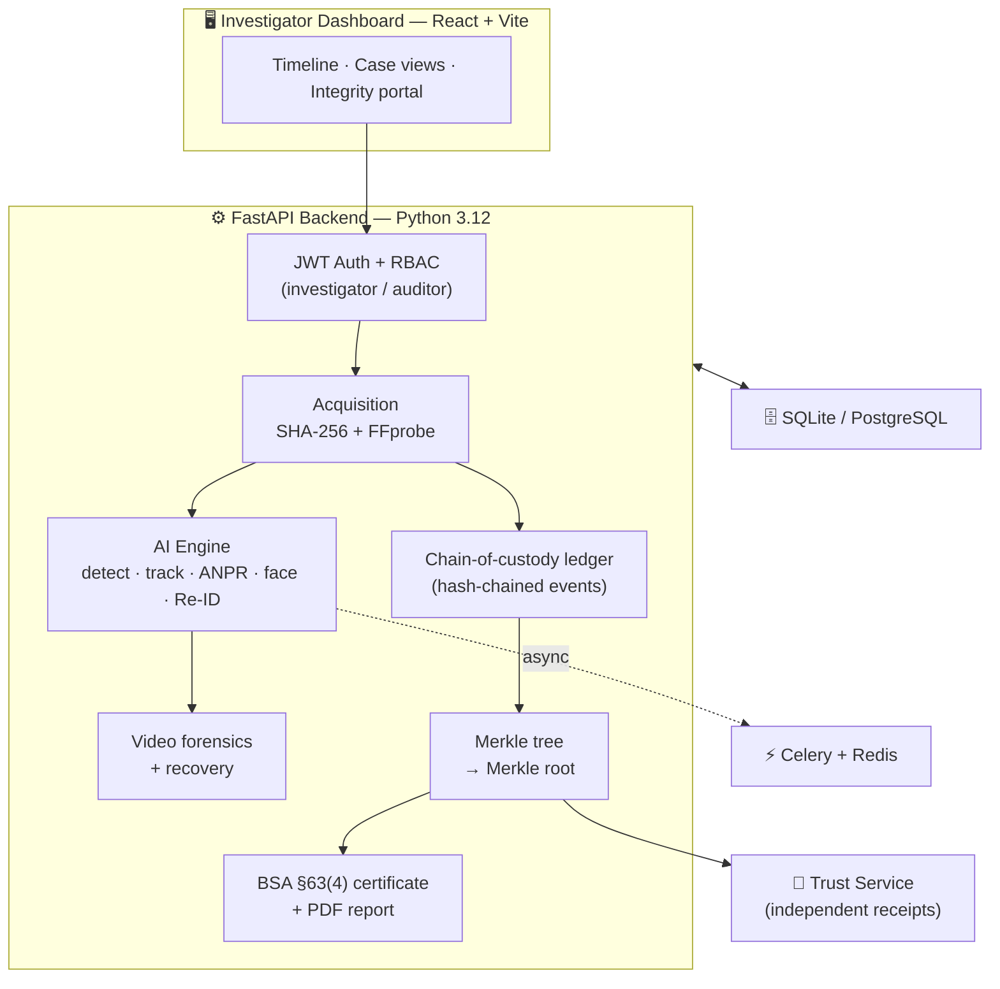

<div align="center">

# 🛡️ SAKSHYA

### Vendor-Agnostic CCTV Forensic Evidence Platform

*Offline-first ingestion, AI triage, deleted-clip recovery, and tamper-evident cryptographic custody — for multi-vendor DVR/NVR surveillance evidence.*

**Smart India Hackathon 2026 · Problem Statement SIH26150 · Team Aroeminds**

[](https://github.com/sayaksatpathi/SAKSHYA/actions/workflows/ci.yml)
[](tests/)
[](https://www.python.org/)
[](https://fastapi.tiangolo.com/)
[](https://react.dev/)
[](docker-compose.yml)
[](LICENSE)

</div>

---

## Overview

**SAKSHYA** is a standardized, **offline-first**, vendor-agnostic forensic platform for multi-vendor DVR/NVR surveillance evidence. It takes raw surveillance footage from any vendor and carries it through a complete, court-oriented pipeline: **evidence ingestion → AI triage → deleted-clip recovery → tamper-evident cryptographic custody → a BSA Section 63(4)-oriented certificate draft.**

> **Honesty-first by design.** Every AI capability reports `AVAILABLE` only when its model is actually loaded — otherwise it returns `UNAVAILABLE` and **never fabricates a result**. Matches are labelled `POSSIBLE_MATCH`; similarity does not establish identity. SAKSHYA produces an *unsigned* certificate draft and does not itself determine legal admissibility.

## 🏛️ Architecture



Two primary layers: a **FastAPI backend** (video forensics, AI models, cryptography, state) and a **React/Vite frontend** (investigator dashboard, timeline views, integrity verification), with an **independent Trust Service** and a **Celery + Redis** async queue.

## ✨ Capabilities

| Area | What it does |
|------|--------------|
| 🔐 **Auth & RBAC** | JWT auth; strict role separation — `investigator` (upload/analyze) vs `auditor` (read-only verification) |
| 📥 **Evidence workflow** | Case segmentation, SHA-256 on ingest, every action appended to a tamper-evident chain of custody |
| 🧠 **AI triage** | Object detection & tracking; **pluggable** ANPR (EasyOCR), face search (SFace), and **cross-camera Re-ID (OSNet)** — each honest about availability |
| 🎞️ **Video forensics** | FFprobe structural anomaly detection, frame-integrity checks |
| ♻️ **Recovery** | Container-level deleted-clip recovery |
| 🔗 **Integrity & trust** | Hash-chained ledger → Merkle root → independently verifiable Trust receipts |
| 📜 **Certificate & reports** | Auto-built **BSA §63(4)** electronic-record certificate draft + all-in-one PDF (findings, timeline, receipts) |

See the full **[Feature Matrix](docs/FEATURE_MATRIX.md)**.

## 🚀 Quickstart

### Option A — Docker (full stack, one command)

```bash
docker compose up --build
# Brings up: backend · trust-service · frontend · redis · celery worker
```

### Option B — Local development

```bash
# Backend
pip install -r requirements.txt            # or requirements-ci.txt for a lean set
python -m uvicorn backend.main:app --reload

# Frontend (separate terminal)
cd frontend && npm install && npm run dev
```

> **AI models** are optional and not committed. Drop model files into `models/` to enable
> the corresponding capability (e.g. `osnet_x1_0.onnx` for Re-ID); without them, those
> features report `UNAVAILABLE`. **FFmpeg/FFprobe** must be on your `PATH` (the Docker image installs it automatically).

## 🧪 Testing & Quality

```bash
pip install -r requirements-ci.txt
ruff check backend tests sakshya     # lint
pytest -q                            # 91 passing, 2 skipped (need models/trust service)
```

CI runs lint + tests (backend) and lint + build (frontend) on every push and PR — see [`.github/workflows/ci.yml`](.github/workflows/ci.yml).

## 📂 Project Structure

```
backend/        FastAPI app — api/, ai/ (engine, detectors, recognizers), services/, models
frontend/       React + Vite investigator dashboard
trust_service/  Independent trust-receipt microservice
sakshya/        Demo CLI
scripts/        Demo & utility scripts
tests/          20 test modules (API, crypto, forensics, AI, e2e)
docs/           Architecture, security, legal, and lifecycle documentation
```

## 📚 Documentation

| Doc | |
|-----|---|
| [Architecture](docs/ARCHITECTURE.md) | System design |
| [AI Pipeline](docs/AI_PIPELINE.md) | Detection → tracking → recognition flow |
| [Evidence Lifecycle](docs/EVIDENCE_LIFECYCLE.md) | Ingest → custody → certificate |
| [Security Model](docs/SECURITY_MODEL.md) | Threats & controls |
| [Data Provenance](docs/DATA_PROVENANCE.md) · [Legal References](docs/LEGAL_REFERENCES.md) | Chain of custody & BSA context |
| [Risk Register](docs/RISK_REGISTER.md) · [Limitations](docs/LIMITATIONS.md) | Honest constraints |
| [Final Demo Script](docs/FINAL_DEMO.md) | Deterministic SIH evaluation walkthrough |

## ⚠️ Current Limitations

1. **FastAPI BackgroundTasks** (default) is not a durable queue — restarts drop queued jobs (Celery + Redis path provided for scale).
2. **Local filesystem storage** by default; use object storage (S3) + PostgreSQL for horizontal scaling.
3. **Some AI capabilities** require heavy optional models (EasyOCR, InsightFace, OSNet).
4. **Proprietary DVR formats** may not be fully parsed/recovered.
5. The **BSA §63(4) certificate is an unsigned draft** — a responsible person must review and authenticate it; SAKSHYA does not determine legal admissibility.
6. **No per-user case isolation (IDOR)** yet — all `investigator`-role users can access all cases; multi-tenant isolation is on the roadmap.

## 📄 License

[MIT](LICENSE) · Third-party components: [THIRD_PARTY_NOTICES.md](THIRD_PARTY_NOTICES.md)

<div align="center">

Built by **Team Aroeminds** · [Sayak Satpathi](https://github.com/sayaksatpathi)

</div>
